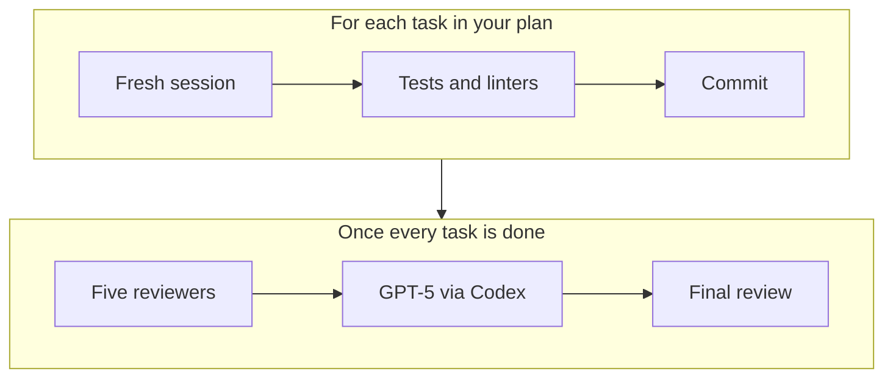

My friend Anton mentioned this to me. I haven't used it yet, but it looks interesting.

Ralphex is a CLI that runs AI coding agents like Claude Code and Codex through a plan you write, one task at a time. Each task gets a fresh session, so the agent's context doesn't fill up with earlier work, and each one runs your tests and linters and gets its own commit.

Once every task is done, the review happens in rounds. First, five agents review the work in parallel, covering quality, implementation, testing, simplification and documentation, and Claude fixes what they find. Then there's an optional second opinion from GPT-5 via Codex, which repeats until there's nothing left to fix. Last, the quality and implementation agents do a final pass for anything critical. There's also a real-time web dashboard for watching it run.

The tagline is "Write a plan. Walk away.", and with a commit per task and the review results, you can see what it did while you were gone.
