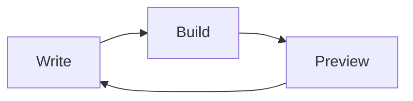

Everything below is written the way a post would write it, and goes through
the same Markdown pipeline. Edit this file (`src/dev/components.mdx`) to try
things out.

## Kbd

Press <Kbd>cmd-Space</Kbd> to open Spotlight, or <Kbd>cmd-shift-4</Kbd> to take
a screenshot. Alternates use a slash: <Kbd>control-left/right</Kbd>. Every
glyph: <Kbd>cmd</Kbd> <Kbd>option</Kbd> <Kbd>control</Kbd> <Kbd>shift</Kbd>
<Kbd>tab</Kbd> <Kbd>return</Kbd> <Kbd>win</Kbd> <Kbd>up</Kbd> <Kbd>down</Kbd>
<Kbd>left</Kbd> <Kbd>right</Kbd>.

## Steps

<Steps>
  <Step>Open: System Settings</Step>
  <Step>Type: "Spotlight" into settings search box</Step>
  <Step>Review: Results from Apps & Results from System</Step>
</Steps>

With keys inside:

<Steps>
  <Step>Open: System Settings</Step>
  <Step>Click: Keyboard Shortcuts... > Modifier Keys</Step>
  <Step>Set: <Kbd>control</Kbd> to <Kbd>cmd</Kbd>, and <Kbd>cmd</Kbd> to <Kbd>control</Kbd></Step>
</Steps>

## Note

<Note>
  Sometimes these settings don't initially stick, and you'll still see files
  in your search results. You need to rebuild the Spotlight index.
</Note>

## Sticky notes

<StickyNote color="sky" label="Tip">
  I know [Raycast](https://www.raycast.com/) and Alfred are popular, but I
  don't use either.
</StickyNote>

A note is written just before the paragraph it annotates. On wide screens it
floats beside it; on a phone it drops below it. Every paper colour:

<StickyNote color="amber" label="amber">The amber paper.</StickyNote>
<StickyNote color="blue" label="blue">The blue paper.</StickyNote>
<StickyNote color="plum" label="plum">The plum paper.</StickyNote>
<StickyNote color="rose" label="rose">The rose paper.</StickyNote>
<StickyNote color="moss" label="moss">The moss paper.</StickyNote>
<StickyNote color="green" label="green">The green paper.</StickyNote>

Two or more notes in a stack, with refs that flip it:

<StickyStack>
  <StickyNote color="sky" label="Tip" marker="1">
    <Kbd>cmd-shift-delete</Kbd> empties the Bin, with a warning first.
  </StickyNote>
  <StickyNote color="amber" label="Gripe" marker="2">
    My least favourite shortcut on the entire system, a fair bit longer than
    the other so the stack has to reserve the taller one's height.
  </StickyNote>
</StickyStack>

- <Kbd>cmd-Del</Kbd> sends it to the Bin. <StickyRef color="sky" n="1" />
- <Kbd>cmd-shift-.</Kbd> shows hidden files. <StickyRef color="amber" n="2" />

## Tabs

Alternatives the reader picks one of. Without JavaScript every panel shows
under its label.

<Tabs>
<Tab label="Homebrew">

```bash
brew install --cask ghostty
```

</Tab>
<Tab label="Download">

Download the disk image from the website and drag it into Applications.

</Tab>
</Tabs>

## Side by side

Two columns on wide screens, stacked on a phone. `color` takes the sticky note papers:

<SideBySide>
<Side label="Before" color="amber">

> Great question! Let me think about this. There are a few moving pieces
> here, and it's worth walking through each of them before we decide.

</Side>
<Side label="After">

> Run `npm test`.

</Side>
</SideBySide>

## Code

```bash
brew install --cask ghostty
git log --oneline -n 5 # recent history
```

```js
export function greet(name = 'world') {
  return `Hello, ${name}!`;
}
```

```
Plain text, no language.
```

## Mermaid



## Everything else Markdown does

A [link to another site](https://astro.build/), some **bold**, some _italic_,
`inline code`, and an emoji shortcode :sparkles:.

| Column | Another |
| ------ | ------- |
| GFM    | tables  |

> A pull quote, the blockquote style.
